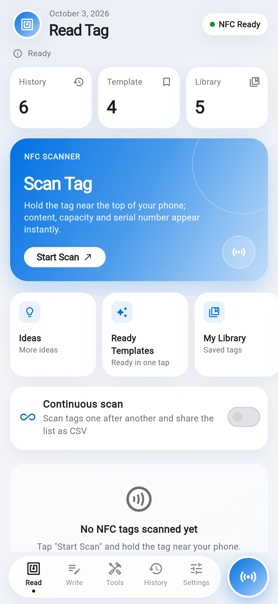
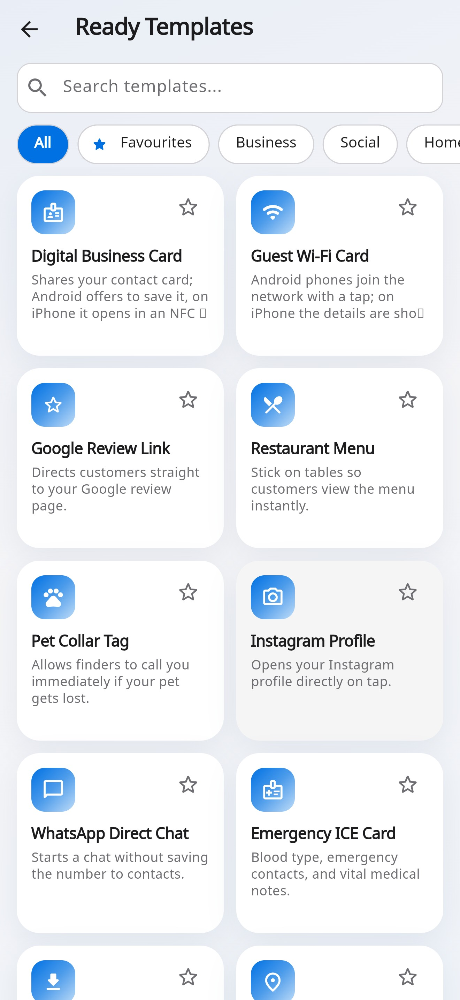
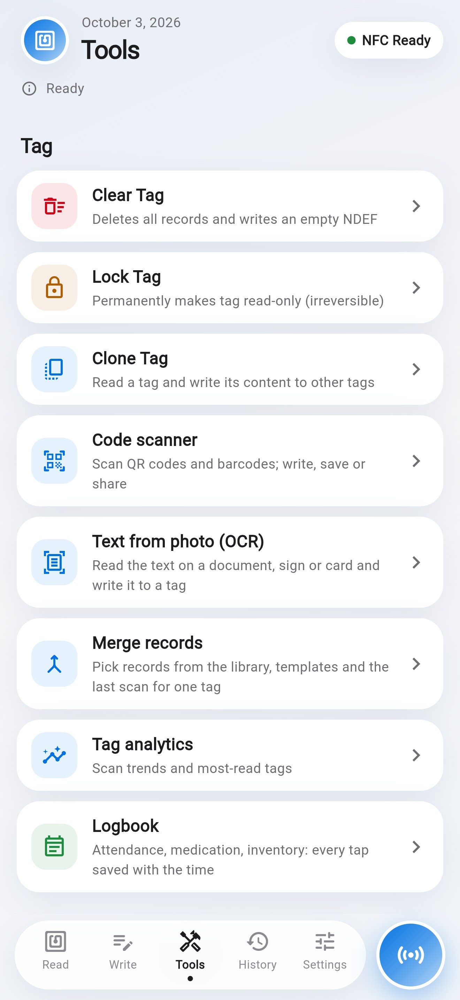
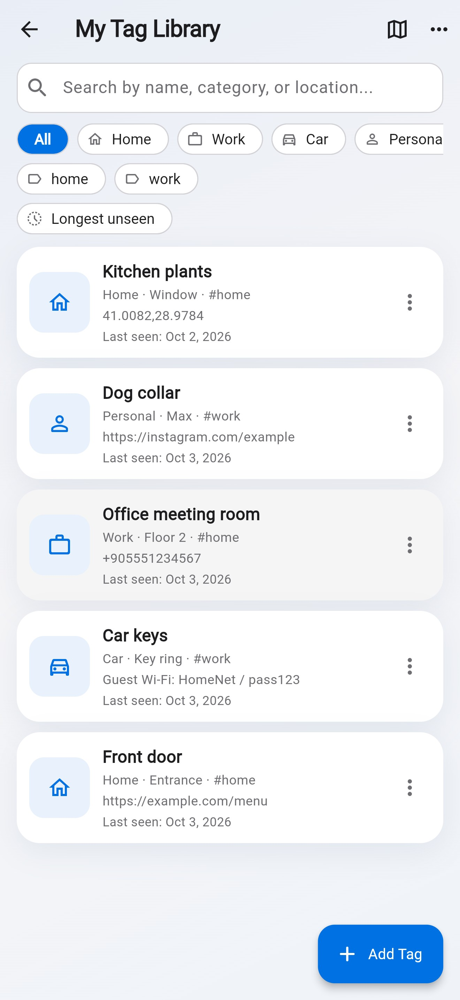

# NFC Tools: Read & Write

Read, write and organize NFC tags on iPhone and Android. Built with Flutter and native platform channels using Core NFC on iOS and `android.nfc` on Android.

- **Version:** 1.8.0; see [the changelog](CHANGELOG.md).
- **Platforms:** iOS 16+ on supported NFC-capable iPhones; Android 7.0+ with NFC hardware.
- **Languages:** English, Turkish, German, French, Spanish, Italian, Portuguese, Russian, Arabic, Japanese, Simplified Chinese, Korean, Dutch and Ukrainian.
- **Default:** new profiles start in English. Existing saved choices, including the system-language option, are preserved.

<p align="center">




</p>

## Capabilities

| Area | Features |
|---|---|
| Read | NDEF records, tag identifiers, chip/capacity information, continuous scanning, comparisons and optional scan history |
| Write | Text, links, contact cards, Wi-Fi, calendar, location and other NDEF records; templates, verification, batch operations and import |
| Tools | Erase, format, memory inspection, supported chip passwords and permanent locking; tag health check (0–100 score with advice) and a treasure-hunt game that writes ordered clues to tags |
| Everyday tools | Unit converter, bill splitter with tip, password generator, dice, coin flip and list draws, tally counter |
| Organization | Tag library, notes, categories, logbooks, maintenance reminders and QR/PDF labels |
| Automation | Shortcuts, deep links, template variables, Home Screen / Lock Screen / Control Center widgets, an Apple Watch app and optional iCloud backup |
| Protection | Device authentication, password-protected backups, signed tags and secure key storage |

Permanent lock operations cannot be undone. Identifier cloning, payment/access-card emulation and copying encrypted sectors are not supported. Tag copying covers supported NDEF content. iOS and Android differ in which records they can open automatically.

## Build and test

The CI toolchain pins Flutter 3.47.5. Install that SDK, then run:

```bash
flutter pub get
flutter gen-l10n
flutter analyze
flutter test
```

Translations are in `lib/l10n/app_<language>.arb`; the existing generation template is `app_tr.arb`. Keep the generated localization files synchronized. Native permission strings and Shortcuts phrases live in the platform projects. CI checks localization consistency, analysis and tests on pushes and pull requests. Separate workflows compile Android and iOS; signed TestFlight uploads require configured Apple credentials and provisioning. Further guides: [App Store release](docs/APP_STORE_RELEASE.md) and [Google Play release](docs/GOOGLE_PLAY_RELEASE.md).

## Storage and recovery

Application data is stored locally. Scan history is opt-in. Before unreadable settings, history, templates, rules, library or logbook files can be replaced by later writes, the original file is copied beside it with a `.corrupt_<timestamp>` suffix. Keep that copy for recovery; it does not reconstruct missing data. The confirmed “Erase all data” action removes these application-owned recovery/temporary/replacement files too, disables automatic cloud backup, and resets every stored preference to its default. If preservation fails, initialization reports the failure instead of silently overwriting the original.

JSON backups can contain private tag contents such as Wi-Fi passwords. Use password protection when exporting sensitive data. Map tiles and explicitly enabled cloud/platform features can use network services; see [privacy details](docs/PRIVACY.md).

## Platform acceptance and release

Simulator and automated tests do not certify NFC hardware behavior. Verify read/write, cancellation, permissions, chip compatibility, locking and backup recovery on real supported devices before store submission.

- [TestFlight setup](TESTFLIGHT_SETUP.md)
- [iPhone build setup](IOS_IPHONE13_SETUP.md)
- [Store listing](docs/STORE_LISTING.md)
- [Device QA checklist](docs/QA_CHECKLIST.md)
- [Detailed feature history (Turkish)](README.tr.md)
